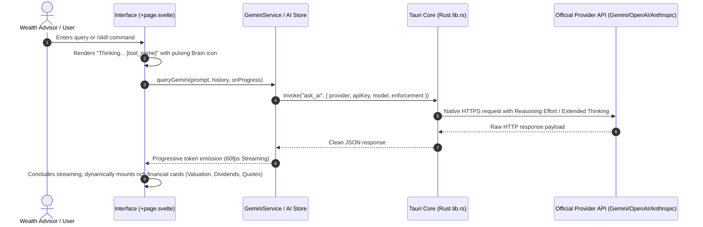

# 🏛️ Staggi — Clean Architecture & Design Documentation

This document outlines the architectural organization of **Staggi**, rooted in the core tenets of **Clean Architecture**, **Clean Code**, and **Separation of Concerns (SoC)**.

---

## 1. Concentric Layer Architecture

The system is organized into concentric layers where dependencies always point inwards: outer layers depend on inner abstractions, while the domain layer remains completely decoupled from frameworks and infrastructure:

```
       +-------------------------------------------------------+
       |                  PRESENTATION LAYER                   |
       |  (Svelte 5 Components, Routes, UI Cards, Modals)      |
       +-------------------------------------------------------+
                                  │
                                  ▼
       +-------------------------------------------------------+
       |                  APPLICATION LAYER                    |
       |  (Svelte 5 Runes Stores, Services, LLM Orchestration) |
       +-------------------------------------------------------+
                                  │
                                  ▼
       +-------------------------------------------------------+
       |                    DOMAIN LAYER                       |
       |  (Pure Entities, Interfaces, Financial Data Types)    |
       +-------------------------------------------------------+
                                  ▲
                                  │
       +-------------------------------------------------------+
       |                 INFRASTRUCTURE LAYER                  |
       |  (Tauri IPC, Rust Backend, LocalStorage, HTTP/MCP)    |
       +-------------------------------------------------------+
```

---

## 2. Layer Specifications

### 2.1 Domain Layer (`src/lib/types/domain/`)
- **Rule**: Pure TypeScript entities with zero framework dependencies.
- **Responsibility**: Establishes unambiguous domain models and contracts:
  - `domain/ai.ts`: Provider definitions (`AIProvider`), reasoning tiers (`EnforcementLevel`), model catalog items (`AIModelOption`).
  - `domain/financial.ts`: Live quotes (`StockQuote`, `ParsedAssetQuote`), dividend schedules, valuation models, corporate events.
  - `domain/chat.ts`: Message payloads, multi-turn history, session structures.
  - `domain/plugins.ts`: Contracts for MCP servers and analytical skills.
  - `domain/tasks.ts`: Background scheduled tasks and execution logs.
- The `src/lib/types/index.ts` file acts as a central **Façade**, providing clean imports from `$lib/types`.

### 2.2 Application Layer (`src/lib/services/`)
- **Responsibility**: Coordinates use cases, business logic, and reactive application state.
- **Implementation via Svelte 5 Runes**:
  - `aiProviderState.svelte.ts`: Manages active provider credentials, validated connection flags, and reasoning configurations.
  - `pluginsState.svelte.ts`: Manages active MCP servers, skills registry, and health checks.
  - `tasksState.svelte.ts`: Asynchronous cron-style scheduler that triggers periodic background queries.
  - `toastService.svelte.ts`: Global reactive notification manager.
  - `geminiService.ts`: Prompt engineering, skill injection, and IPC delegation to the native Rust layer.
  - `chatSessionService.ts`: Local multi-session persistence and active session lifecycle.

### 2.3 Presentation Layer (`src/lib/components/` & `src/routes/`)
- **Responsibility**: Reactive, accessible, and high-performance user interface.
- **Modular Decomposition**:
  - `SettingsModal.svelte`: Refactored from a monolithic modal into 4 modular subcomponents:
    - `SettingsAiTab.svelte`
    - `SettingsMcpsTab.svelte`
    - `SettingsSkillsTab.svelte`
    - `SettingsTasksTab.svelte`
    - `TaskResultModal.svelte`
  - `ChatMessageItem.svelte`: Message renderer supporting 60fps streaming and dynamic mounting of rich financial cards.
  - `SpotlightBar.svelte`: Global shortcut-driven launcher for assets, prompts, and skills.
  - `cards/`: High-density financial data cards (`AssetQuoteCard`, `ValuationProjectionCard`, `AssetDividendsCard`, `CorporateEventsCard`, `ComparisonTableCard`, `AssetProfileCard`).

### 2.4 Infrastructure Layer (`src-tauri/` & `src/lib/utils/`)
- **Responsibility**: Hardware bridge, operating system integration, and direct network communication.
  - `src-tauri/src/lib.rs`: High-performance Rust backend handling secure HTTP requests to Google Gemini, OpenAI, Anthropic, and Yahoo Finance APIs without browser CORS restrictions.
  - `src/lib/utils/formatters.ts`: Reusable pure utility functions for temporal and monetary transformations.

---

## 3. Execution Sequence Diagram



---

## 4. Key Architectural Gains

1. **Code Reusability & DRY**:
   - Utilities such as `formatRelativeTime` and `formatMinutesLabel` are consolidated in `formatters.ts`, removing duplications across views.
2. **Maintainability**:
   - Monolithic components eliminated (e.g., `SettingsModal.svelte` reduced from ~1,900 lines to ~180 modular lines).
   - Clean boundaries between UI view, application state, and domain contracts.
3. **Optimized for LLM Code Generation**:
   - `LLMS.md` provides unambiguous conventions and navigation maps so that automated agents can extend features without breaking architectural integrity.
