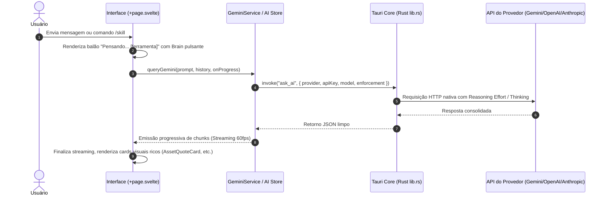

# 🏛️ Staggi — Clean Architecture & Design Documentation

Este documento estabelece a organização arquitetural do **Staggi**, fundamentada nos princípios de **Clean Architecture**, **Clean Code** e **Separação de Responsabilidades (SoC)**.

---

## 1. Visão Arquitetural em Camadas

O projeto adota uma arquitetura concêntrica onde dependências sempre apontam para o centro (as camadas mais externas conhecem as mais internas, mas as camadas centrais nunca dependem das externas):

```
       +-------------------------------------------------------+
       |                  PRESENTATION LAYER                   |
       |  (Svelte 5 Components, Routes, UI Cards, Modals)      |
       +-------------------------------------------------------+
                                  │
                                  ▼
       +-------------------------------------------------------+
       |                  APPLICATION LAYER                    |
       |  (Svelte 5 Runes Stores, Services, LLM Orchestration) |
       +-------------------------------------------------------+
                                  │
                                  ▼
       +-------------------------------------------------------+
       |                    DOMAIN LAYER                       |
       |  (Pure Entities, Interfaces, Financial Data Types)    |
       +-------------------------------------------------------+
                                  ▲
                                  │
       +-------------------------------------------------------+
       |                 INFRASTRUCTURE LAYER                  |
       |  (Tauri IPC, Rust Backend, LocalStorage, HTTP/MCP)    |
       +-------------------------------------------------------+
```

---

## 2. Detalhamento das Camadas

### 2.1 Camada de Domínio (`src/lib/types/domain/`)
- **Regra**: Não contém código de framework nem dependências externas.
- **Responsabilidade**: Define as entidades, tipos e contratos estritos do ecossistema:
  - `domain/ai.ts`: Modelos de provedores (`AIProvider`), níveis de raciocínio (`EnforcementLevel`), catálogo de modelos (`AIModelOption`).
  - `domain/financial.ts`: Cotações (`StockQuote`, `ParsedAssetQuote`), dividendos, valuation, eventos corporativos.
  - `domain/chat.ts`: Estrutura de mensagens, histórico de conversas e sessões.
  - `domain/plugins.ts`: Contratos para Servidores MCP e Skills especializadas.
  - `domain/tasks.ts`: Tarefas agendadas e logs de execução.
- O arquivo `src/lib/types/index.ts` atua como **Façade** central, permitindo imports limpos de `$lib/types`.

### 2.2 Camada de Aplicação (`src/lib/services/`)
- **Responsabilidade**: Gerenciamento de estado e regras de negócio fiduciárias.
- **Implementação com Svelte 5 Runes**:
  - `aiProviderState.svelte.ts`: Gerencia o provedor ativo, chaves validadas e configurações de raciocínio.
  - `pluginsState.svelte.ts`: Gerencia a lista de MCPs ativos e Skills disponíveis.
  - `tasksState.svelte.ts`: Agendador assíncrono de tarefas que executa queries em background.
  - `geminiService.ts`: Orquestração de prompts, injeção de Skills e comunicação com a ponte Rust.
  - `chatSessionService.ts`: Controle de histórico de chat e persistência.

### 2.3 Camada de Apresentação (`src/lib/components/` & `src/routes/`)
- **Responsabilidade**: Interface de usuário reativa, fluida e modularizada.
- **Refatoração de Componentes Monolíticos**:
  - `SettingsModal.svelte` foi decomposto em 4 abas modulares especializadas:
    - `SettingsAiTab.svelte`
    - `SettingsMcpsTab.svelte`
    - `SettingsSkillsTab.svelte`
    - `SettingsTasksTab.svelte`
    - `TaskResultModal.svelte`
  - `ChatMessageItem.svelte`: Renderizador de mensagens com streaming em tempo real e injeção dinâmica de cards visuais.
  - `SpotlightBar.svelte`: Acesso rápido via teclado para tickers e skills.

### 2.4 Camada de Infraestrutura (`src-tauri/` & `src/lib/utils/`)
- **Responsabilidade**: Comunicação com o sistema operacional, chamadas de rede e persistência.
  - `src-tauri/src/lib.rs`: Backend nativo Rust responsável por requisições HTTP seguras, evitando restrições de CORS e processando chamadas para as APIs do Google Gemini, OpenAI, Anthropic e Yahoo Finance.
  - `src/lib/utils/formatters.ts`: Utilitários puros e reutilizáveis de formatação temporal e financeira.

---

## 3. Diagrama de Fluxo de Execução



---

## 4. Benefícios Obtidos com a Nova Organização

1. **Reaproveitamento de Código**:
   - Funções utilitárias como `formatRelativeTime` e `formatMinutesLabel` foram centralizadas em `formatters.ts`, eliminando duplicações em múltiplos componentes.
2. **Manutenibilidade e Legibilidade**:
   - Redução de arquivos monolíticos (`SettingsModal.svelte` reduzido de 1900 para ~180 linhas).
   - Separação clara entre visualização, estado e regras de domínio.
3. **Mapeamento Amigável para IAs**:
   - O arquivo `LLMS.md` na raiz do projeto orienta qualquer modelo de IA ou desenvolvedor sobre onde cada parte do sistema está localizada, evitando alterações equivocadas.
