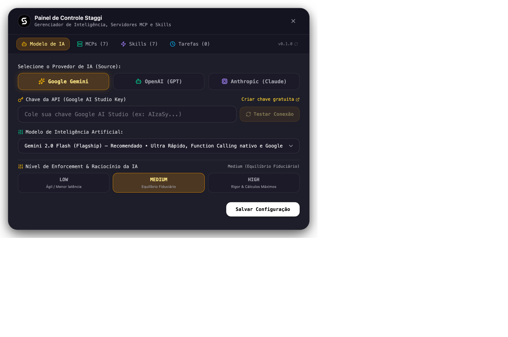
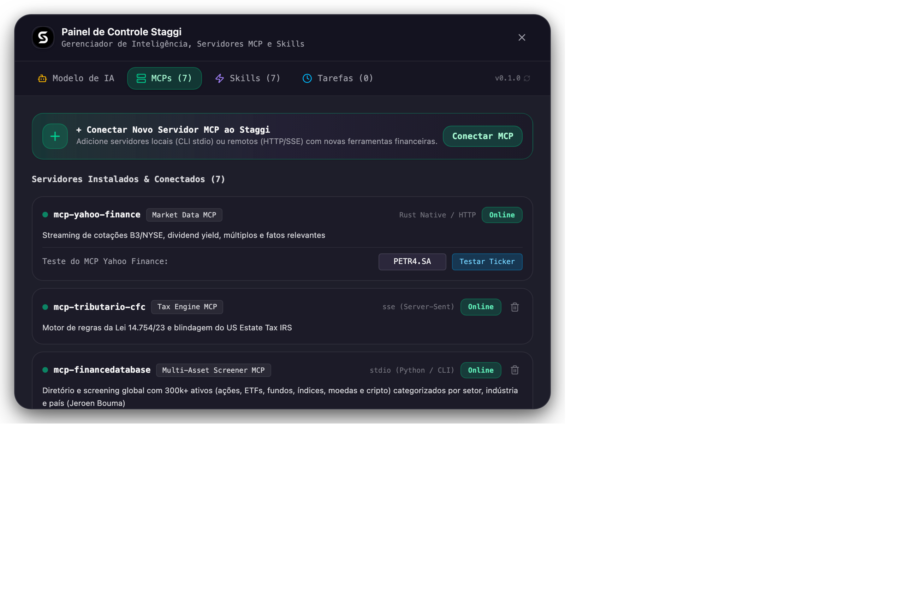

<div align="center">


# Staggi — AI Wealth Launcher

**The executive desktop copilot and market intelligence engine built for investment advisors, family offices, and wealth managers.**

[](https://v2.tauri.app/)
[-FF3E00?style=for-the-badge&logo=svelte&logoColor=white)](https://svelte.dev/)
[](https://www.rust-lang.org/)
[](https://tailwindcss.com/)
[](https://bun.sh/)
[](LICENSE)

<br/>

<p align="center">
  <a href="#-overview">Overview</a> •
  <a href="#-visual-showcase">Showcase</a> •
  <a href="#-key-features">Key Features</a> •
  <a href="#-security--zero-leak-architecture">Security & Zero-Leak</a> •
  <a href="#-installation--running">Installation</a> •
  <a href="#-llms--autonomous-agents-guide">LLMs Guide</a>
</p>

---

</div>

<br/>

## 📸 Visual Showcase

<div align="center">
  
</div>

<br/>

<div align="center" style="display: flex; gap: 16px; justify-content: center; flex-wrap: wrap;">
  
  
</div>

---

## 💎 Overview

**Staggi** is an ultra-fast, native desktop application (crafted in **Rust** and **Svelte 5 Runes**) designed specifically for the analytical workflow of wealth advisors, capital allocators, and fiduciary portfolio managers.

It unifies:
1. **Multi-LLM Flagship Engine**: Seamless native integration with Google Gemini (2.0 Flash, Flash Thinking), OpenAI (GPT-4o, o1, o3-mini), and Anthropic Claude 3.7 Sonnet with Extended Thinking.
2. **Real-Time Official Market Data**: Direct integration with B3, NYSE, Nasdaq, and global exchanges via a native Rust backend (zero fragile scraping, zero mock data).
3. **Model Context Protocol (MCP)**: Native orchestration of local and remote MCP servers for balance sheet breakdowns, ETF holdings, fixed income debt schedules, and insider transaction tracking.
4. **Specialized Analytical Skills (`SKILL.md`)**: Instant invocation of institutional financial frameworks such as `/valuation` (Graham, Bazin, Multiples), `/dividends`, `/screening`, and `/fixed-income` directly from the Spotlight bar (`Ctrl+Space` / `Cmd+Space`).
5. **Background Automations**: Scheduled routines that quietly monitor portfolios, corporate disclosures, and dividend announcements, delivering proactive executive briefs.

---

## ⚡ Key Features

- 🧠 **Contextual "Thinking..." Indicator with Pulsing Brain**: Transparent real-time feedback displaying which tool, MCP server, or skill is actively running (`Thinking... [Yahoo Finance Market Data]`, `Thinking... [Skill: Valuation]`, etc.).
- 🌊 **Smooth 60fps Progressive Streaming**: Natural token-by-token response rendering with an animated pulsing cursor `▌`, eliminating freezes and abrupt text dumps.
- 🎯 **Configurable Reasoning Enforcement Levels**:
  - `LOW`: Fast, synthesized responses with minimal latency.
  - `MEDIUM`: Balanced fiduciary standard.
  - `HIGH`: Maximum cognitive rigor featuring step-by-step mathematical audits, formula derivation, and exhaustive multi-factor tables (`reasoning_effort` for OpenAI and `thinking` budget for Anthropic).
- 🧩 **Rich Interactive Financial Cards**:
  - `AssetQuoteCard`: Real-time stock prices, intraday spread, and trading volume.
  - `ValuationProjectionCard`: Graham Formula, Bazin Dividend Ceiling Price (6% DY threshold), and margin of safety.
  - `AssetDividendsCard`: Declared payouts, historical 12-month Dividend Yield, and ex-dividend dates.
  - `CorporateEventsCard`: Official CVM/SEC filings structured by regulatory materiality and impact.
  - `ComparisonTableCard`: Side-by-side multiple comparison across sector peers.
  - `AssetProfileCard`: Complete institutional profile, asset class, issuer, benchmark, and administration metrics.
- 🔔 **Floating Toast Notification System**: Immediate contextual feedback in the upper viewport with auto-dismiss, replacing cumbersome bottom banners.
- 🚀 **Global Spotlight Launcher**: Summon Staggi from anywhere on your desktop with a global keyboard shortcut (`Ctrl+Space` / `Cmd+Space`).

---

## 🛡️ Security & Zero-Leak Architecture (Strict Fiduciary Privacy)

> [!IMPORTANT]
> **Complete Privacy and Direct Connection (Zero-Telemetry):**
> Staggi is engineered strictly under fiduciary security standards:

1. **100% Local Sandboxed Storage**:
   - Your API keys (`Google AI Studio`, `OpenAI Platform`, `Anthropic Console`) and chat history remain **exclusively on your local machine** within Tauri's isolated OS sandbox.
   - **Zero intermediary proxy servers**: All AI and market requests originate from your local desktop binary directly to official provider endpoints (`api.openai.com`, `generativelanguage.googleapis.com`, `api.anthropic.com`).
2. **Clean Git Repository Policy**:
   - No API keys, tokens, or private secrets are ever committed into the codebase.
   - The `.gitignore` file strictly blocks environment configs (`.env`, `.env.*`), cryptographic keys (`*.pem`, `*.key`), and build artifacts.
3. **Secure Native Bridge**:
   - External HTTPS requests are handled by the native Rust backend ([src-tauri/src/lib.rs](src-tauri/src/lib.rs)), bypassing webview CORS limitations and preventing token exposure in browser script runtimes.

---

## 🏗️ Project Structure (Clean Architecture)

```
staggi/
├── LLMS.md                     # Canonical guide for AI coding assistants and LLMs
├── ARCHITECTURE.md             # In-depth architectural diagrams and data flows
│
├── src-tauri/                  # Native Rust Backend (Tauri 2.0 Core)
│   ├── src/lib.rs              # IPC Commands (ask_ai, test_ai_connection, fetch_yahoo_data...)
│   └── Cargo.toml              # Rust Dependencies (reqwest, serde, tauri)
│
└── src/                        # Frontend (SvelteKit + Svelte 5 Runes)
    ├── routes/                 # Presentation Layer & Routes
    │   ├── +layout.svelte      # Global shell with ToastContainer
    │   └── +page.svelte        # Core Workspace: Chat, Spotlight, Session Drawer
    │
    └── lib/
        ├── types/domain/       # Domain Layer: Strict typing for AI, Financial, MCPs, Tasks
        ├── services/           # Application Layer: Svelte 5 reactive stores & orchestrators
        ├── utils/              # Utility Layer: Formatters, UI helpers, tailwind-merge
        └── components/         # UI Layer: Modular Svelte 5 components
            ├── settings/       # Settings Tabs (AI, MCPs, Skills, Tasks)
            └── cards/          # Dynamic Financial Response Cards (Valuation, Quotes, Dividends...)
```

---

## 🚀 Installation & Running

### Prerequisites
- [Node.js](https://nodejs.org/) (v18+) and [Bun](https://bun.sh/) installed.
- [Rust](https://www.rust-lang.org/) (cargo v1.80+).
- Platform-specific Tauri build tools (see [Tauri Prerequisites](https://v2.tauri.app/start/prerequisites/)).

### 1. Clone the Repository
```bash
git clone https://github.com/vieirinhasantana/staggi.git
cd staggi
```

### 2. Install Frontend Dependencies
```bash
bun install
```

### 3. Run in Desktop Development Mode
```bash
bun run tauri dev
```

### 4. Type Check & Production Build
```bash
# Type check Svelte 5 Runes and TypeScript
bun run check

# Compile production binary (.dmg / .app / .deb / .msi)
bun run tauri build
```

---

## 📦 Releases & Versioning

Staggi adheres to [Semantic Versioning](https://semver.org/spec/v2.0.0.html). For a full history of updates, releases, and architectural improvements, consult the **[CHANGELOG.md](CHANGELOG.md)**.

Platform desktop bundles (.dmg, .app, .deb, .AppImage, .msi) are available under the **[Releases](https://github.com/vieirinhasantana/staggi/releases)** section.

---

## 👥 Contributors & Community

Contributions from the open-source and financial engineering community are warmly welcomed!

- **How to Contribute**: Please review **[CONTRIBUTING.md](CONTRIBUTING.md)** for our development workflow, Svelte 5 Rune conventions, and PR checklist.
- **Security & Privacy**: Consult **[SECURITY.md](SECURITY.md)** for vulnerability reporting procedures and local-only secret protection.
- **Issue Tracking**: Submit bug reports and feature proposals using our interactive [Issue Templates](https://github.com/vieirinhasantana/staggi/issues).

<p align="center">
  <a href="https://github.com/vieirinhasantana/staggi/graphs/contributors">
    
  </a>
</p>

---

## 🤖 LLMs & Autonomous Agents Guide

For AI coding agents and autonomous workflows exploring or modifying Staggi:
- Read **[LLMS.md](LLMS.md)** at the root of the repository for full structural mapping, domain contracts, and coding rules.
- Review **[ARCHITECTURE.md](ARCHITECTURE.md)** for sequence diagrams, concentric layer constraints, and clean design patterns.

---

## 📄 License

Distributed under the **MIT** License. See [LICENSE](LICENSE) for details.

<div align="center">
  <sub>Engineered with analytical rigor and fiduciary-grade privacy.</sub>
</div>
