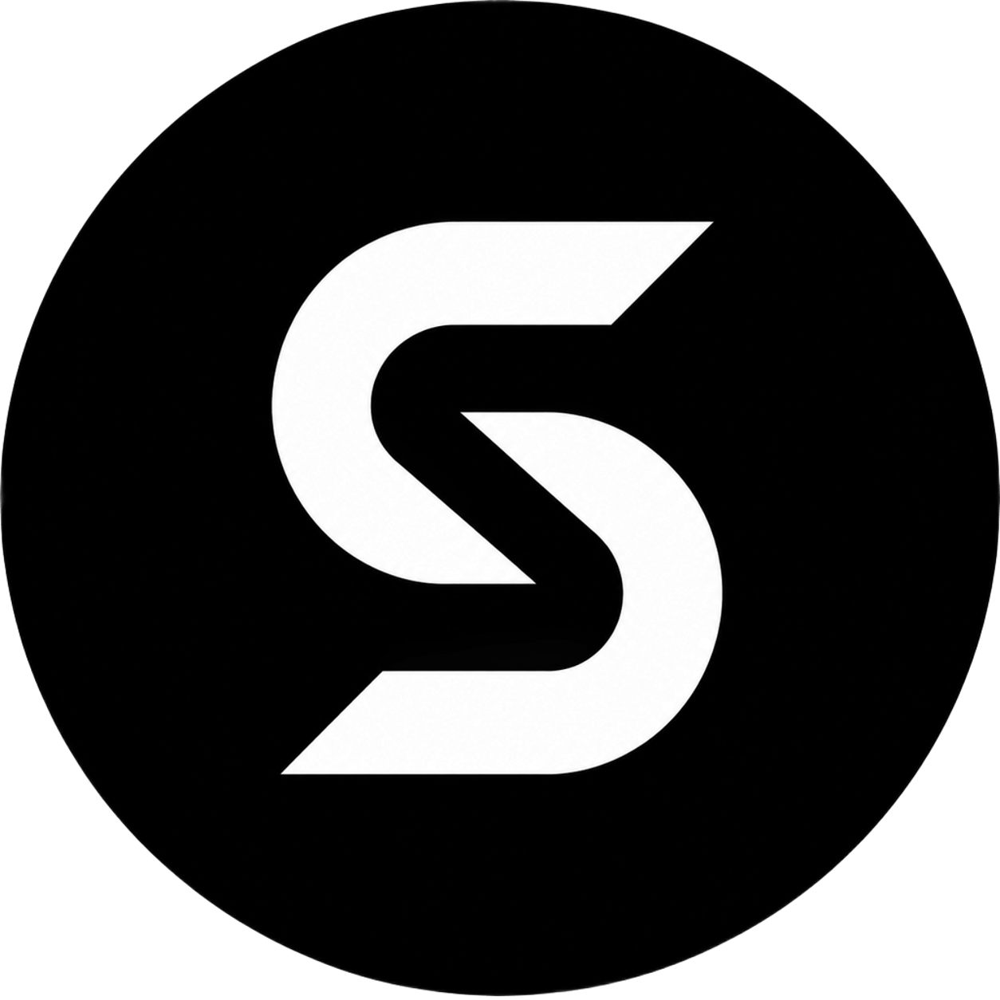
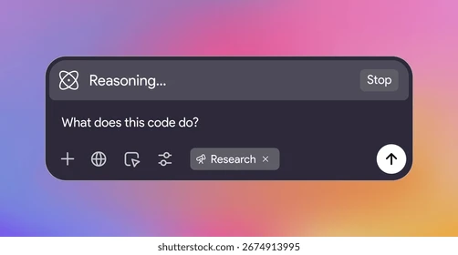
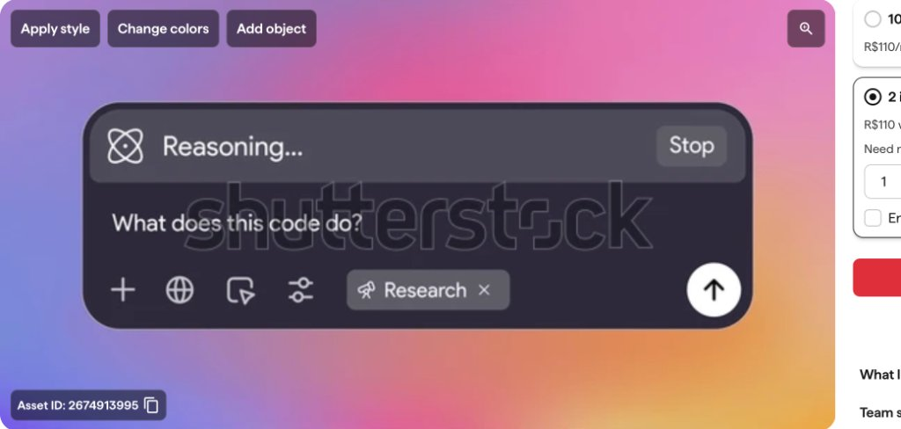

<div align="center">


# Staggi — AI Wealth Launcher

**O copiloto executivo e motor de inteligência financeira desktop para consultores de investimento, family offices e wealth managers.**

[](https://v2.tauri.app/)
[-FF3E00?style=for-the-badge&logo=svelte&logoColor=white)](https://svelte.dev/)
[](https://www.rust-lang.org/)
[](https://tailwindcss.com/)
[](https://bun.sh/)
[](LICENSE)

<br/>

<p align="center">
  <a href="#-visão-geral">Visão Geral</a> •
  <a href="#-capturas-de-tela">Demonstração</a> •
  <a href="#-principais-recursos">Recursos</a> •
  <a href="#-arquitetura-e-segurança">Segurança & Zero-Leak</a> •
  <a href="#-instalação-e-execução">Instalação</a> •
  <a href="#-documentação-para-llms">Guia de LLMs</a>
</p>

---

</div>

<br/>

## 📸 Demonstração Visual

<div align="center">
  
</div>

<br/>

<div align="center" style="display: flex; gap: 16px; justify-content: center; flex-wrap: wrap;">
  
  
</div>

---

## 💎 Visão Geral

O **Staggi** é uma plataforma desktop nativa ultra-rápida (desenvolvida em **Rust** e **Svelte 5 Runes**) projetada especificamente para o fluxo de trabalho de assessores de investimentos, alocadores de capital e gestores de patrimônio fiduciário.

Ele unifica:
1. **Multi-LLM Flagship Engine**: Suporte nativo a Google Gemini 2.5/2.0, OpenAI (GPT-4o, o1, o3-mini) e Anthropic Claude 3.7 Sonnet com Extended Thinking.
2. **Dados Oficiais de Mercado em Tempo Real**: Conexão com B3, NYSE, Nasdaq e bases globais via backend nativo em Rust (sem scraping frágil e sem dados mockados).
3. **Protocolo MCP (Model Context Protocol)**: Orquestração de servidores locais e remotos para análise de balanços, holdings de ETFs, dívida pública/privada (Bonds) e insider tracking.
4. **Skills Especializadas (SKILL.md)**: Acione frameworks analíticos complexos como `/valuation` (Graham, Bazin, Múltiplos), `/proventos`, `/screening` e `/renda-fixa` diretamente na barra Spotlight (`Ctrl+Espaço`).
5. **Automações em Segundo Plano**: Rotinas periódicas que monitoram carteiras, proventos e fatos relevantes de forma silenciosa e geram relatórios executivos.

---

## ⚡ Principais Recursos

- 🧠 **Indicador "Pensando..." com Cérebro Pulsante**: Feedback visual transparente sobre qual ferramenta ou skill está sendo orquestrada em tempo real (`Pensando... [Yahoo Finance Market Data]`, `Pensando... [Skill: Valuation]`, etc.).
- 🌊 **Streaming Progressivo a 60fps**: Respostas fluidas e naturais geradas token a token com cursor pulsante `▌`, sem travamentos ou dumps de texto.
- 🎯 **Níveis de Raciocínio (Enforcement Level)**:
  - `LOW`: Modo ágil e sintetizado para respostas imediatas.
  - `MEDIUM`: Equilíbrio fiduciário padrão.
  - `HIGH`: Máximo rigor cognitivo com cálculo passo a passo, fórmulas auditadas e tabelas exaustivas (`reasoning_effort` nativo na OpenAI e `budget_tokens` na Anthropic).
- 🧩 **Cards Ricos Financeiros**:
  - `AssetQuoteCard`: Cotação em tempo real, variação intraday e volume.
  - `ValuationProjectionCard`: Modelos de Graham, Preço Teto de Bazin (DY 6%) e margem de segurança.
  - `AssetDividendsCard`: Payouts declarados, histórico de Dividend Yield anual e datas-com.
  - `CorporateEventsCard`: Fatos relevantes CVM/SEC estruturados por relevância de impacto.
  - `ComparisonTableCard`: Comparativo lado a lado de múltiplos entre pares setoriais.
- 🔔 **Sistema Flutuante de Notificações (Toasts)**: Alertas contextuais imediatos no canto superior da tela com auto-dismiss, sem banners empurrando o layout para baixo.
- 🚀 **Spotlight Launcher Global**: Abra o Staggi instantaneamente a qualquer momento por atalho de teclado global (`Ctrl+Espaço` / `Cmd+Espaço`).

---

## 🛡️ Arquitetura de Segurança & Zero-Leak (Segurança Rigorosa)

> [!IMPORTANT]
> **Privacidade Absoluta e Conexão Direta (Zero-Telemetry):**
> O Staggi foi concebido sob princípios estritos de segurança fiduciária:

1. **Armazenamento 100% Local**:
   - Suas chaves de API (`Google AI Studio`, `OpenAI Platform`, `Anthropic Console`) e conversas permanecem **estritamente na sua máquina local** (armazenamento seguro da sandbox Tauri no SO).
   - **Nenhum servidor intermediário**: As requisições partem do seu binário desktop diretamente para os endpoints oficiais das provedoras (`api.openai.com`, `generativelanguage.googleapis.com`, `api.anthropic.com`).
2. **Repositório Limpo de Segredos**:
   - Nenhuma chave de API, segredo ou token privado está versionado ou embutido no código-fonte.
   - O arquivo `.gitignore` bloqueia preventivamente qualquer arquivo de ambiente (`.env`, `.env.*`), chaves criptográficas (`*.pem`, `*.key`) e artefatos de build.
3. **Ponte de Execução Segura**:
   - As chamadas HTTP externas são executadas pelo backend nativo em Rust ([src-tauri/src/lib.rs](src-tauri/src/lib.rs)), contornando restrições de CORS e eliminando a exposição de credenciais no runtime de scripts do navegador.

---

## 🏗️ Estrutura do Projeto (Clean Architecture)

```
staggi/
├── LLMS.md                     # Guia canônico para IAs e LLMs entenderem o projeto
├── ARCHITECTURE.md             # Diagramas arquiteturais e fluxos de dados
│
├── src-tauri/                  # Backend Nativo Rust (Tauri 2.0)
│   ├── src/lib.rs              # Comandos IPC (ask_ai, test_ai_connection, fetch_yahoo_data...)
│   └── Cargo.toml              # Dependências Rust (reqwest, serde, tauri)
│
└── src/                        # Frontend SvelteKit + Svelte 5
    ├── routes/                 # Interface principal e rotas
    │   ├── +layout.svelte      # Shell com ToastContainer global
    │   └── +page.svelte        # Chat central, Drawer de sessões e Spotlight
    │
    └── lib/
        ├── types/domain/       # Camada de Domínio: Contratos puros de IA, Finanças, MCPs e Tasks
        ├── services/           # Camada de Aplicação: Stores reativas Svelte 5 e orquestradores
        ├── utils/              # Camada Utilitária: Formatadores e helpers reutilizáveis
        └── components/         # Camada de Apresentação: Componentes Svelte 5 modulares
            ├── settings/       # Abas modulares de IA, MCPs, Skills e Tarefas
            └── cards/          # Cards de resposta financeira (Valuation, Cotações, Proventos...)
```

---

## 🚀 Instalação e Execução

### Pré-requisitos
- [Node.js](https://nodejs.org/) (v18+) e [Bun](https://bun.sh/) instalado.
- [Rust](https://www.rust-lang.org/) (cargo v1.80+).
- Dependências de sistema do Tauri instaladas (veja o [Guia de Pré-requisitos do Tauri](https://v2.tauri.app/start/prerequisites/)).

### 1. Clonar o Repositório
```bash
git clone https://github.com/seu-usuario/staggi.git
cd staggi
```

### 2. Instalar Dependências do Frontend
```bash
bun install
```

### 3. Executar em Modo de Desenvolvimento Desktop
```bash
bun run tauri dev
```

### 4. Checagem de Tipos e Build de Produção
```bash
# Validação de tipos do Svelte 5
bun run check

# Compilação da aplicação final para distribuição (.dmg / .app / .deb / .msi)
bun run tauri build
```

---

## 🤖 Documentação para LLMs & Agentes Autônomos

Para inteligências artificiais e agentes que precisam navegar, entender ou estender o código-fonte do Staggi:
- Consulte o arquivo **[LLMS.md](LLMS.md)** na raiz do repositório para obter o mapeamento estrutural detalhado de cada componente, fluxo de dados e diretrizes de desenvolvimento.
- Consulte **[ARCHITECTURE.md](ARCHITECTURE.md)** para visualizar o diagrama de sequência do orquestrador de IA e os princípios de Clean Architecture implementados.

---

## 📄 Licença

Distribuído sob a licença **MIT**. Consulte o arquivo [LICENSE](LICENSE) para obter mais informações.

<div align="center">
  <sub>Construído com rigor analítico e foco em privacidade patrimonial.</sub>
</div>
